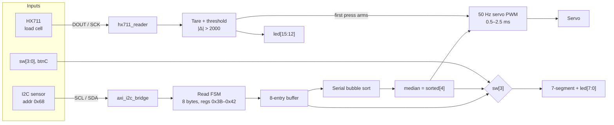
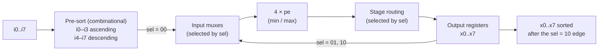

# Seismic Health Monitoring (SHM) System on FPGA

A seismic health monitoring (SHM) system in Verilog for the Digilent Basys 3. It reads an I²C sensor and an HX711 load cell, computes the median of 8 sensor bytes, shows the result on the LEDs and 7-segment display, and drives a servo with it.

The repo also contains a parallel 8-input **bitonic sorter** (a Xilinx ISE project) that sorts the same number of values as the SHM sample buffer. The SHM top level currently sorts with its own serial bubble sort; the bitonic sorter is not wired into it.

## Status

**Working**
- Bitonic sorter: sorts any 8 inputs in 3 clock cycles. Verified in simulation (see [Simulate](#simulate)) and re-run automatically on every push by GitHub Actions.
- SHM design: I²C sensor read, HX711 read with tare and threshold, median filter, 7-segment/LED display and servo PWM. The code is syntax-checked by the same GitHub Actions run; hardware results are not documented here yet.

**Current limitations**
- The sensor is read once. After reset the design reads its 8 bytes, sorts them and then idles until `btnC` is pressed again. Only the HX711 side runs continuously.
- The 8 values are 8 consecutive registers (`0x3B`–`0x42`) from a single read pass, not 8 samples taken over time.
- There is no seismic or health decision logic yet: no vibration metric, threshold or alarm driven by the sensor. The only threshold is the load-cell press detection (±2000 counts), which arms the servo.
- The bitonic sorter is not connected to the SHM top level.

**Possible next steps**
- Sample the sensor repeatedly and keep a rolling window of samples over time.
- Compute a vibration metric from that window and compare it against a threshold.
- Drive an alert output (LED or buzzer) from the comparison.
- Use `bitonic_sorter/parallel_sorter` for the median instead of the bubble sort.
- Add photos, a wiring diagram and hardware results.

## Repository layout

```
shm_system/
  src/top_shm_system.v       current design: I2C sensor + HX711 + servo
  constraints/basys3.xdc     pin constraints for the current design
  archive/v1_lfsr_demo/      earlier demo that used an LFSR instead of real sensors
bitonic_sorter/            Xilinx ISE 14.7 project (open ParallelSorter.xise)
  pe.v                       compare-exchange unit
  parallel_sorter.v          8-input sorter (top level)
  sorter_tb.v                original single-vector testbench
  sim/                       self-checking testbench + Makefile (Icarus Verilog)
```

## SHM system (Basys 3)

The pin assignments in `constraints/basys3.xdc` are for a Digilent Basys 3 (100 MHz clock on W5).



### What the current design does

- **Sensor read.** After reset, an FSM does an I²C write to address `0x68`, then reads eight bytes from registers `0x3B`–`0x42` into an 8-entry buffer. The I²C master is `axi_i2c_bridge` (in `top_shm_system.v`).
- **Median.** Once the buffer is full, it is sorted by a serial bubble sort and `sorted[4]` is taken as the median.
- **Display.** The 7-segment display and `led[7:0]` show the value in decimal / binary. `sw[3]=1` shows `buffer[sw[2:0]]`; `sw[3]=0` shows the median.
- **Load cell.** `hx711_reader` reads 24-bit samples (25 clock pulses per conversion). The first reading after reset is latched as the tare. A "press" is `|reading − tare| > THRESHOLD` (2000 counts). `led[15:12]` are `0000` while calibrating or pressed and `1111` when resting. Adjust `THRESHOLD` in `top_shm_system.v` to match your load cell.
- **Servo.** The servo output stays low until the first press, then outputs 50 Hz PWM with a pulse width of 0.5 ms + median × 7.84 µs (0.5–2.5 ms). `btnC` resets everything, including the "armed" latch.

### Pins

| Signal | FPGA pin |
|--------|----------|
| `servo` | J1 |
| `i2c_scl` | J2 | 
| `i2c_sda` | G2 | 
| `hx711_dout` | A14 | 
| `hx711_sck` | A16 |

`btnC` is the reset button. `sw[3:0]` select what is displayed.

### Build with Vivado

1. Create an RTL project for the Basys 3 part (`xc7a35tcpg236-1`).
2. Add `shm_system/src/top_shm_system.v` as a design source and `shm_system/constraints/basys3.xdc` as a constraint file.
3. Set `top_shm_system` as the top module, then run synthesis, implementation and generate the bitstream.

### v1 (archive)

`archive/v1_lfsr_demo/` is the first version. It has no sensors: `btnC` (reset) restarts a sampling run, and once it is released the design captures a free-running LFSR value every 50 ms into the 8-entry buffer. The median of those values positions the servo. It uses 8 LEDs and its own constraints file.

## Bitonic sorter



### How it works

1. **Pre-sort (combinational).** Two small 4-element sorting networks sort `i0..i3` ascending and `i4..i7` descending. Together they form a bitonic sequence.
2. **Bitonic merge (3 clock cycles).** Four processing elements (`pe`, which outputs `S1 = min(A,B)` and `S2 = max(A,B)`) are reused for each stage. Input muxes controlled by `sel` feed them from the output registers:

| Clock edge | `sel` | Compares elements at distance |
|-----------:|:-----:|:------------------------------|
| 1 | `00` | 4 (inputs are loaded here) |
| 2 | `01` | 2 |
| 3 | `10` | 1 → `x0..x7` now hold the sorted result |

### Interface (`parallel_sorter`)

| Port | Dir | Description |
|------|-----|-------------|
| `clk` | in | Clock |
| `rst_n` | in | Asynchronous, active-low reset; clears `x0..x7` |
| `sel[1:0]` | in | Stage select: `00`, `01`, `10`. `11` holds the outputs |
| `i0..i7` | in | Unsigned inputs, `DATA_WIDTH` bits each (default 8). Only sampled on the `sel=00` edge |
| `x0..x7` | out | Registered outputs, ascending (`x0` is the smallest) after the `sel=10` edge |

The `sel` sequence `00 → 01 → 10` has to be driven from outside; no controller is included. See `sorter_tb.v` for an example.

### Simulate

With [Icarus Verilog](https://steveicarus.github.io/iverilog/) (no Xilinx tools needed):

```sh
cd bitonic_sorter/sim
make          # self-checking test, exits non-zero on any mismatch
make demo     # original sorter_tb.v: 25 10 90 5 35 70 42 8 -> 5 8 10 25 35 42 70 90
```

`make` runs three phases against a reference sort: all 256 exhaustive 0/1 input patterns, 20,000 random full-range vectors, and 20,000 random vectors in the range 0–3 (heavy on duplicates). The design is a pure comparator network, so by the 0-1 principle the exhaustive 0/1 phase covers every possible input.

### ISE

Open `bitonic_sorter/ParallelSorter.xise` in ISE 14.7. The project targets a Spartan-3E XC3S500E (-4, FG320) and uses ISim.

## Authors

| Name | GitHub | 
|------|--------|
| [Asmitha Sathya Niranjan] | [@Asmitha Sathya Niranjan](https://github.com/asmith-sathya-niranjan) |
| [Harshitha Jagadish] | [@Harshitha Jagadish](https://github.com/their-username) | 
| [Harivallabh Ashok] | [@Harivallabh Ashok](https://github.com/their-username) | 

